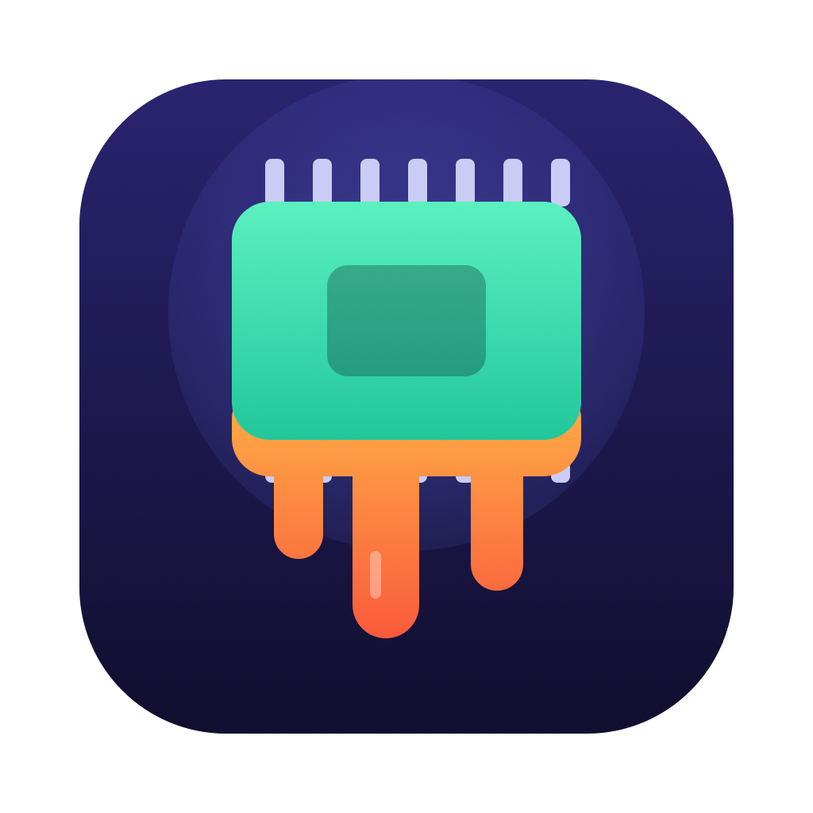
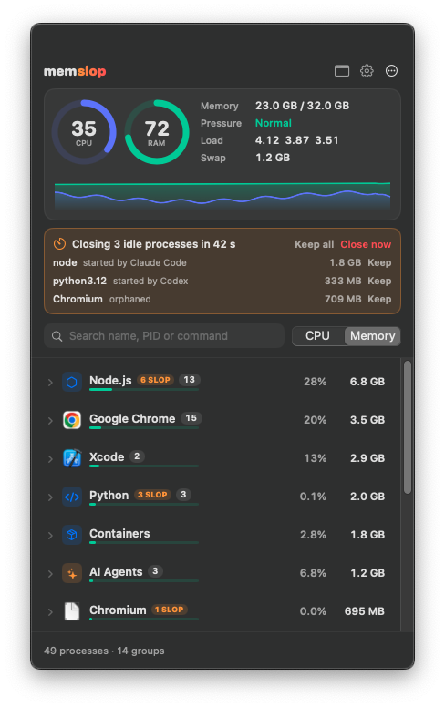
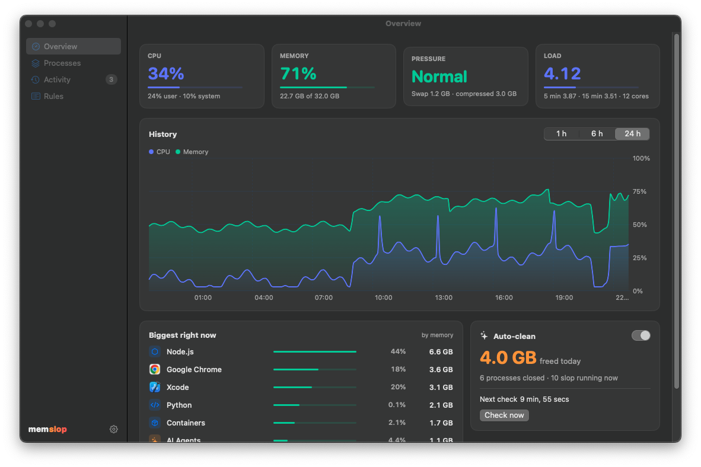
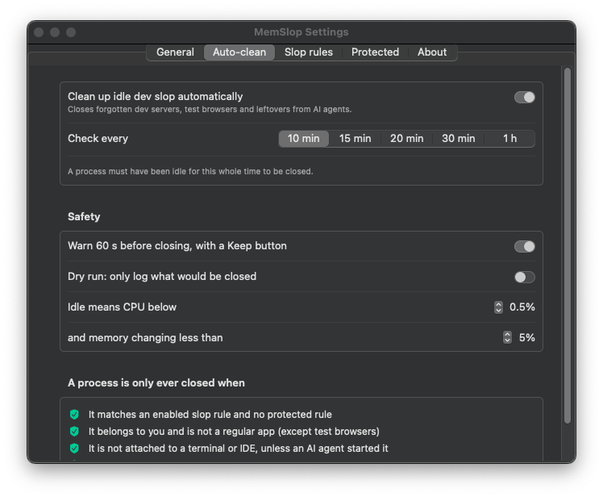

<p align="center">
  
</p>

<h1 align="center">MemSlop</h1>

<p align="center">
  <strong>Your AI agents leave slop running. MemSlop cleans it up.</strong><br>
  A native macOS menu bar app for CPU and RAM that closes the dev servers, test browsers and
  leftovers Claude Code, Codex and friends forget about.
</p>

<p align="center">
  <a href="https://github.com/ericrisco/mem-slop/actions/workflows/ci.yml"></a>
  <a href="https://github.com/ericrisco/mem-slop/releases/latest"></a>
  
  <a href="LICENSE"></a>
</p>

<p align="center">
  
  &nbsp;
  
</p>

## Install

```bash
curl -fsSL https://raw.githubusercontent.com/ericrisco/mem-slop/main/install.sh | bash
```

The script downloads the latest release, checks its SHA-256, installs `MemSlop.app` into
`/Applications` (or `~/Applications`), links the `memslop` command and opens the app. Run it
again to upgrade.

| You want to… | Run |
| --- | --- |
| Install a specific version | `curl -fsSL …/install.sh \| bash -s -- --version 1.0.0` |
| Build from source instead | `curl -fsSL …/install.sh \| bash -s -- --from-source` |
| Skip the `memslop` command | `curl -fsSL …/install.sh \| bash -s -- --no-cli` |
| Uninstall (app, settings, data) | `curl -fsSL …/install.sh \| bash -s -- --uninstall` |

Or from a clone: `make install`. You need macOS 14 Sonoma or later. Apple Silicon and Intel are
both supported.

## Why

You ask an agent to "run the app and check it works". It starts `next dev`, a `uvicorn` server, a
Playwright Chromium and an `esbuild` service. Then the session ends and they keep running. A
week later, Activity Monitor shows 200 `node` processes and your Mac is swapping.

MemSlop shows you that at a glance and cleans it up, without touching the apps you use or the
server you started in your own terminal.

## Features

**In the menu bar**
- CPU and RAM percentage, in six styles: both, stacked, mini bars, CPU only, RAM only or icon only.

**One click away**
- Gauges for CPU and RAM, plus memory pressure, load average, swap and a live trend.
- Processes grouped the way you think about them. All Chrome helpers go under *Google Chrome*.
  Interpreters go under their family: *Python* (including `uv`), *Node.js*, *AI Agents* (Claude
  Code, Codex, Gemini CLI…), *Databases*, *Containers*…
- Every row shows the **ports** it listens on (`:3000`, `:8000`) and the **project** it runs in, so
  `node` becomes "the Next.js of *shop* on :3000".
- Group by kind or **by project**. Sort by CPU or memory. Search by name, PID, port, project or
  command line.
- Quit one process, a whole group or a selection. Apps are asked to quit like the Dock does.
  Other processes get `SIGTERM`, then `SIGKILL` if they ignore it for 5 seconds.

**Auto-clean**
- Every 10 minutes (10, 15, 20, 30 or 60), MemSlop closes dev slop that has been idle for that
  whole time.
- A 60-second warning with **Keep** and **Close now**, in the panel and as a notification.
- When memory pressure stays **critical** for 30 seconds, it checks right away instead of waiting.
  Under pressure, 5 idle minutes are enough. Same rules, same warning, same Keep button.
- Dry-run mode, an editable rule list, a protected list and an activity log.
- A **memory freed** counter: today in the panel, and the total since install in the dashboard.
  Processes you quit by hand count too.

**Agents**
- When a Claude Code, Codex or other agent session ends, what it left running is closed once
  idle for 5 minutes. No rule needed: the session that wanted it is gone. Same warning and Keep.
- Works out of the box by noticing the agent process exit. Run `memslop hooks install` (or
  **Settings → Agents → Connect**) to also catch servers the agent detached, the moment the
  session ends.

**Command line**

```console
$ memslop status
CPU 23%   Memory 71% (22.7 GB of 32.0 GB)   Pressure normal   Swap 1.2 GB
6 slop processes using 3.9 GB — see them with `memslop ps --slop`

$ memslop ports
PORT   PID     NAME                  PROJECT                  MEMORY  SLOP
:3000  51234   node                  shop                     1.8 GB  Next.js dev server
:8000  51410   python3.12            api                      340 MB  Uvicorn

$ memslop quit :3000
```

Also `memslop ps [--slop] [--json]` and `memslop ports --json`, handy for agents that need to
know what is already running before they start another server.

**Dashboard**
- 24 hours of CPU and memory history. Hover any moment to see which groups were using the memory.
- Biggest consumers now, memory freed today, the full activity log and the rule editors.

## How auto-clean decides

A process is closed only when **all** of these are true:

1. It matches an enabled **slop rule** (for example `next dev`, `uvicorn`, `vite/bin/vite.js`,
   `ms-playwright`) and no **protected rule**.
2. It belongs to you and is **not a regular app** with a Dock icon. Throwaway test browsers
   (Chrome for Testing, Playwright, Puppeteer) are the only exception.
3. Its parent chain does **not** reach a terminal, IDE, `tmux` or `ssh` session, **unless** an
   AI agent CLI sits in between. A server you started in iTerm is safe. The same server started by
   Claude Code inside iTerm is fair game, and so is anything orphaned to `launchd`.
4. It **and all its children** were idle for the whole interval: average CPU under 0.5% and
   memory changing by less than 5% (at least 10 MB). MemSlop must have watched it the entire time,
   so nothing is closed in the first interval after launch or wake.
5. It stayed idle during the 60-second warning, and you did not press **Keep**.

Discord, ChatGPT, Obsidian, Mail, Slack and other everyday apps are on the protected list by
default, and regular apps are never candidates anyway. Every rule can be edited, disabled or
restored to its default in **Settings → Slop rules / Protected**.

<p align="center">
  
</p>

## Privacy

MemSlop makes no network requests and has no telemetry or accounts. History and the activity
log stay in `~/Library/Application Support/MemSlop` and are pruned after 24 hours (only the
"freed since install" total is kept). It needs no
special permissions. It only reads and signals your own processes, and asks once to show
notifications.

## FAQ

**macOS says the app can't be checked for malicious software.**
Releases are signed ad hoc, not notarized. The install script removes the quarantine flag for
you. If you downloaded the zip by hand, run `xattr -dr com.apple.quarantine /Applications/MemSlop.app`
or right-click the app and choose **Open**.

**Will it kill the dev server I'm using?**
Not if you started it in your own terminal or IDE (rule 3), or if it handled a request during
the warning (rule 5). If you want a server never to be touched, add a protected rule for it,
for example *Command contains* `my-api`.

**How much does MemSlop use itself?**
About 20 MB and well under 1% CPU with the panel closed. MemSlop counts itself in the list, and
you can't quit it from there.

**Can I try it without it closing anything?**
Turn on **Dry run** in Settings → Auto-clean. Or run the demo with fake data:
`open /Applications/MemSlop.app --args --demo --open=dashboard`.

## Development

```bash
make test      # unit tests (Swift Testing)
make run       # build MemSlop.app and open it
make demo      # open the app with synthetic data
make verify    # build with warnings as errors, test, bundle
make release   # universal build + zips + checksums in dist/
```

The code is split into `MemSlopCore`, a UI-free library with every decision covered by tests, and
the `MemSlop` app (AppKit status item plus SwiftUI). See [docs/ARCHITECTURE.md](docs/ARCHITECTURE.md)
and [CONTRIBUTING.md](CONTRIBUTING.md).

## License

[MIT](LICENSE) © Eric Risco
